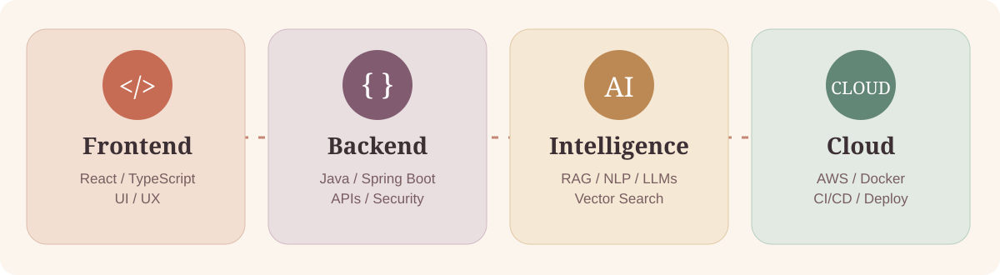
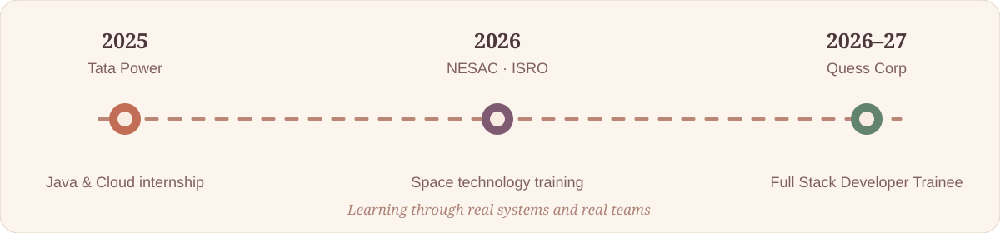
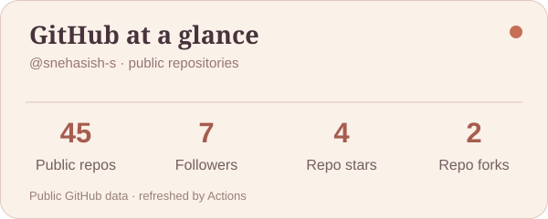
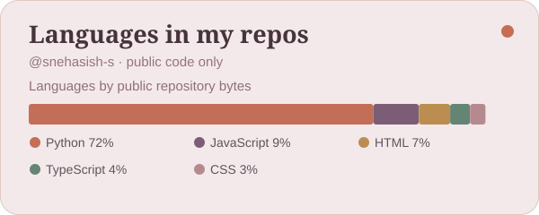

<!--
  Warm Editorial GitHub Profile • Omm Snehasish Parida
  Use in the public repo: snehasish-s/snehasish-s
  Local artwork under assets/ is self-hosted, and animated SVGs have reduced-motion support.
  Skills under "Exploring next" are learning areas, not assertions of production experience.
-->
<div align="center">


<a href="https://git.io/typing-svg"></a>

<p>
<a href="https://github.com/snehasish-s?tab=followers"></a>
<a href="https://www.linkedin.com/in/snehasish-s"></a>
<a href="mailto:paridaommsnehasish@gmail.com"></a>
<a href="https://omm-snehasish-parida.onrender.com/"></a>
</p>

<a href="#-a-little-about-me">About</a> &nbsp;·&nbsp; <a href="#-my-toolkit">Skills</a> &nbsp;·&nbsp; <a href="#-work-im-proud-of">Projects</a> &nbsp;·&nbsp; <a href="#-the-journey-so-far">Experience</a> &nbsp;·&nbsp; <a href="#-github-in-motion">Activity</a>


</div>

## ☕ A little about me

> I'm a computer science student and full-stack developer who likes the space where **software engineering, thoughtful interfaces, and practical artificial intelligence** meet. I enjoy taking an idea from database design to deployment—and making the result understandable to real people.

- 📍 Based in **Bhubaneswar, Odisha, India** · B.Tech in CSE, expected **2027**.
- 💼 Currently **Full Stack Developer Trainee at Quess Corp**.
- 🌱 Building with **Java, Spring Boot, React, TypeScript, Python, FastAPI, SQL, and Docker**.
- 🧠 Interested in **AI engineering, RAG systems, NLP, LLM applications, and explainable AI workflows**.
- 🛰️ Also exploring **geospatial systems, remote sensing, and IoT**.
- 🤝 Happy to collaborate on practical open-source and product ideas.

```java
public class AboutMe {
    String philosophy = "Build with empathy. Engineer for reliability.";
    String[] passions = { "Full Stack", "Generative AI", "Cloud", "Learning" };
}
```

## 🧰 My toolkit

<div align="center">

</div>

### Languages & frontend

<p></p>

**Java · Python · JavaScript · TypeScript · SQL · C · React · HTML5 · CSS3 · Tailwind CSS · Vite · Responsive Design · State Management · REST API Integration**

### Backend, architecture & security

<p></p>

**Spring Boot · Spring MVC · Spring Security · Spring Data JPA · Hibernate · FastAPI · Flask · Node.js & Express fundamentals · REST APIs · JWT · RBAC · CRUD · DTOs · Input Validation · Pagination · API Documentation · MVC and Layered Architecture**

### Databases, data & vector retrieval

<p></p>

**PostgreSQL · MySQL · Microsoft SQL Server · SQL Queries and Joins · JPA/Hibernate ORM · ChromaDB · Vector Embeddings · Semantic Search · Data Modeling**

### AI, machine learning & GenAI

<p></p>

**Machine Learning Fundamentals · Deep Learning Fundamentals · Neural Networks · Natural Language Processing · LLM Applications · RAG · Prompt Engineering · Embeddings · Document Chunking · OCR Pipelines · Vector Retrieval · Ollama · Source-grounded Answers**

### Cloud, DevOps & engineering tools

<p></p>

**AWS · Docker · Docker Compose · Git & GitHub · GitHub Actions · CI/CD · AWS CodePipeline / CodeBuild · Render · REST Testing · Linux Basics · Agile Collaboration**

### Geospatial & embedded systems

**GIS · Remote Sensing · Satellite Imagery · Sentinel and MODIS Data · NDVI · Geospatial Processing · Arduino · IoT Sensor Integration**

<details>
<summary><strong>🌿 What I'm learning next (expanding my toolkit)</strong></summary>

**AI & GenAI:** Transformers, Hugging Face, LangChain, LangGraph, AI agents, tool calling, multi-agent orchestration, hybrid retrieval, reranking, RAG evaluation, fine-tuning / LoRA, LLM observability, MLOps, PyTorch, TensorFlow.

**Full stack & system design:** Next.js, GraphQL, WebSockets, advanced TypeScript, React performance, Redis caching, Kafka, RabbitMQ, event-driven design, microservices, API gateways, integration testing, design patterns, rate limiting, OAuth 2.0.

**Cloud & infrastructure:** Kubernetes, Terraform, monitoring, observability, infrastructure-as-code, advanced AWS deployment patterns, scalable distributed systems.

</details>

## 🧠 How I put AI to work

<div align="center"></div>

In projects such as **Vertebra Research** and **AgentForge**, I work on the flow from uploaded documents to extracted text, embeddings, retrieval, and useful, source-aware responses. I care about clarity and traceability as much as model output.

## 🚀 Work I'm proud of

<table>
<tr>
<td width="50%" valign="top">
<h3>⚡ <a href="https://github.com/snehasish-s/FlowSync">FlowSync Pro</a></h3>
<p><b>React · TypeScript · Spring Boot · PostgreSQL · JWT · Docker</b></p>
<p>Full-stack task and operations platform with secure access, work tracking, blockers, handovers, and cloud deployment.</p>
<a href="https://github.com/snehasish-s/FlowSync">Code</a> · <a href="https://flowsync-web.onrender.com/">Live demo</a>
</td>
<td width="50%" valign="top">
<h3>📚 Vertebra Research</h3>
<p><b>FastAPI · React · ChromaDB · SQL Server · Ollama</b></p>
<p>Document intelligence assistant with OCR, chunking, retrieval and generated answers grounded in source context.</p>
<p><i>Applied RAG / document intelligence</i></p>
</td>
</tr>
<tr>
<td width="50%" valign="top">
<h3>🧠 AgentForge</h3>
<p><b>Python · FastAPI · ChromaDB · React</b></p>
<p>AI document operations prototype connecting searchable knowledge with an interactive full-stack workspace.</p>
</td>
<td width="50%" valign="top">
<h3>🛰️ Geospatial Disaster Monitoring</h3>
<p><b>GIS · Remote Sensing · Docker · APIs</b></p>
<p>Satellite-data-oriented flood monitoring and geographic risk analysis.</p>
<a href="https://gdms-2026.onrender.com/">Project demo</a>
</td>
</tr>
<tr>
<td width="50%" valign="top">
<h3>🌡️ HeatSense Edge</h3>
<p><b>Arduino · Sensors · IoT · Edge Logic</b></p>
<p>Environmental monitoring prototype with sensor readings, automated alerts and control logic.</p>
</td>
<td width="50%" valign="top">
<h3>⚙️ <a href="https://github.com/snehasish-s/PowerGrid">PowerGrid</a></h3>
<p><b>Java · Spring Boot · REST APIs · Docker</b></p>
<p>Backend services for power-distribution data and operations workflows.</p>
<a href="https://github.com/snehasish-s/PowerGrid">Code</a>
</td>
</tr>
<tr>
<td width="50%" valign="top">
<h3>🔧 DevOps Pipeline Visualizer</h3>
<p><b>Flask · GitHub Webhooks · AWS</b></p>
<p>Pipeline dashboard for CI/CD activity, build status and deployment visibility.</p>
<a href="https://my-devopsdashboard.onrender.com/">Project demo</a>
</td>
<td width="50%" valign="top">
<h3>🏦 <a href="https://github.com/snehasish-s/akaunt-project">Akaunt</a></h3>
<p><b>Java · Spring Boot · MySQL</b></p>
<p>Enterprise management backend with modular services, structured data and APIs.</p>
<a href="https://github.com/snehasish-s/akaunt-project">Code</a>
</td>
</tr>
</table>

## 🗺️ The journey so far

<div align="center"></div>

| Period | Experience | Focus |
|:--|:--|:--|
| **Oct 2026 – Jan 2027** | **Full Stack Developer Trainee · Quess Corp** | Full-stack architecture, Spring Boot, React, team development |
| **Jan 2026** | **Space Technology Trainee · NESAC (ISRO, Dept. of Space)** | Satellite data, GIS, remote sensing |
| **Jun–Jul 2025** | **Java & Cloud Developer Intern · Tata Power Group** | Backend APIs, Java, Docker and cloud fundamentals |

🎓 **B.Tech · Computer Science & Engineering** — Aryan Institute of Engineering and Technology, Bhubaneswar · Expected 2027.

## 🏆 Moments worth remembering

| Achievement | Highlight |
|:--|:--|
| 🤖 ISRO Robotics Challenge 2026 | Qualified through Round 4 |
| 🏆 IIIT Bhubaneswar Hackathon | Winner |
| 🎯 BPUT Hackathon | Selected presenter at BPUT Rourkela |
| ☁️ Google Cloud | Associate Cloud Engineer learning journey via Coursera |

## 📈 GitHub in motion

<div align="center">


</div>

<sub>These graphics live inside this repository, so broken third-party stats websites do not affect them. Run <b>Refresh GitHub profile metrics</b> under Actions once to populate real counts, then refresh automatically each day. Language percentages reflect public code volume, not skill proficiency.</sub>

### 🐍 Contribution garden

<div align="center">
<p><i>Every small contribution is part of the bigger picture.</i></p>
<picture>
<source media="(prefers-color-scheme: dark)" srcset="https://raw.githubusercontent.com/snehasish-s/snehasish-s/output/github-contribution-grid-snake-dark.svg" />
<source media="(prefers-color-scheme: light)" srcset="https://raw.githubusercontent.com/snehasish-s/snehasish-s/output/github-contribution-grid-snake.svg" />

</picture>
</div>

<sub>For the first-time snake setup, open Actions → Generate contribution snake → Run workflow. The image appears after the output branch is published successfully.</sub>

## 💌 Let's connect

I'm interested in thoughtful full-stack projects, intelligent developer tools, accessible software and learning with other builders.

<div align="center">
<a href="https://www.linkedin.com/in/snehasish-s"></a>
<a href="mailto:paridaommsnehasish@gmail.com"></a>
<a href="https://omm-snehasish-parida.onrender.com/"></a>

</div>
