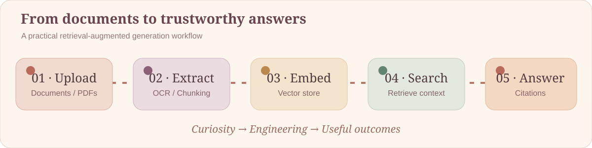

<!--
  GITHUB PROFILE README — snehasish-s
  Required repo: https://github.com/snehasish-s/snehasish-s (PUBLIC)
  Put this file at the repository root. Upload assets/ and .github/workflows/ too.
  Personal facts and achievements were adapted from the existing profile README.
  Tools under "Currently exploring" are learning interests, not claimed expertise.
-->
<div align="center">



<br />

<a href="https://git.io/typing-svg"></a>

<br />

<a href="https://github.com/snehasish-s"></a>
<a href="https://github.com/snehasish-s?tab=followers"></a>
<a href="https://www.linkedin.com/in/snehasish-s"></a>
<a href="mailto:paridaommsnehasish@gmail.com"></a>
<a href="https://omm-snehasish-parida.onrender.com/"></a>

**<a href="#-about-me">About</a> · <a href="#-technical-toolkit">Skills</a> · <a href="#-selected-projects">Projects</a> · <a href="#-professional-journey">Experience</a> · <a href="#-contribution-activity">Activity</a> · <a href="#-lets-connect">Contact</a>**

</div>

---

## 👨‍💻 About Me

> **I develop end-to-end applications where strong software engineering meets useful artificial intelligence.** My focus spans Java/Spring Boot backends, React interfaces, Python-based GenAI systems, retrieval-augmented generation (RAG), and cloud deployment.

```yaml
name: Omm Snehasish Parida
based_in: Bhubaneswar, Odisha, India
education: B.Tech in Computer Science & Engineering | Expected 2027
focus:
  - Full-stack applications and secure backend architecture
  - Applied AI, large language models and RAG solutions
  - AWS, Docker, DevOps and production deployment
  - Geospatial computing, remote sensing and IoT
currently: Full Stack Developer Trainee @ Quess Corp
principle: "Build things that solve real problems, not just demos."
```

- 🔭 **Building:** full-stack products, document-intelligence applications, and AI-assisted workflows.
- 🧠 **Interested in:** machine learning, NLP, neural networks, embeddings, LLM applications, and reliable AI systems.
- ⚙️ **Engineering with:** Spring Boot, Spring Security, React, TypeScript, FastAPI, SQL, and Docker.
- ☁️ **Cloud-minded:** AWS concepts, containerization, CI/CD pipelines, and deployment automation.
- 🤝 **Open to:** engineering collaboration, AI product ideas, research-minded projects, and open source.

---

## 🧰 Technical Toolkit

<div align="center">

### 🧑‍💻 Programming Languages


**Java · Python · TypeScript · JavaScript · SQL · C**

### 🌐 Frontend & Full Stack


**React · TypeScript · HTML5 · CSS3 · Tailwind CSS · Vite · Node.js fundamentals · Express.js fundamentals · Responsive UI · REST integration**

### ⚙️ Backend, APIs & Security


**Spring Boot · Spring MVC · Spring Security · Spring Data JPA · Hibernate · FastAPI · Flask · REST APIs · JWT · RBAC · DTO validation · Layered architecture · API testing**

### 🗄️ Databases & Data


**PostgreSQL · MySQL · Microsoft SQL Server · SQL queries, joins & indexing fundamentals · ChromaDB (vector database) · Data modeling**

### 🤖 Artificial Intelligence & GenAI


**Machine Learning · Deep Learning · NLP · Neural Networks · LLM Applications · Retrieval-Augmented Generation (RAG) · Prompt Engineering · Embeddings · Semantic Search · Vector Retrieval · Document AI · Ollama · ChromaDB**

**Currently exploring and developing further:** Transformers · LangChain · LangGraph · Hugging Face · Agentic AI · Multi-Agent Workflows · LLM Fine-Tuning · Model Evaluation · PyTorch · TensorFlow · Scikit-learn · MLOps

### ☁️ Cloud, DevOps & Developer Tools


**AWS · Docker · Docker Compose · Git/GitHub · GitHub Actions · CI/CD · AWS CodePipeline / CodeBuild · Render · Git workflow · Linux basics**

**Learning next:** Kubernetes · Terraform · advanced system design · distributed messaging and Kafka

### 🛰️ Geospatial & Hardware


**GIS · Remote Sensing · Satellite Imagery · Sentinel & MODIS Data · NDVI Analysis · Geospatial Data Pipelines · Arduino · Sensor Integration · IoT Prototyping**

</div>

---

## 🧠 How I Build AI Systems

<div align="center">

</div>

I enjoy building **retrieval-augmented generation (RAG)** pipelines that transform unstructured material into searchable, context-aware answers. My implementations connect document processing, embeddings, ChromaDB, FastAPI, Ollama, and a React frontend, with attention to traceability and citations.

---

## 🚀 Selected Projects

<table>
<tr>
<td width="50%" valign="top">
<h3>⚡ <a href="https://github.com/snehasish-s/FlowSync">FlowSync Pro</a></h3>
<p><strong>React · TypeScript · Spring Boot · PostgreSQL · JWT · Docker</strong></p>
<p>Full-stack operations and task management with secure authentication, task tracking, blockers, handovers, and cloud deployment.</p>
<p><a href="https://github.com/snehasish-s/FlowSync">Source Code</a> · <a href="https://flowsync-web.onrender.com/">Live Demo</a></p>
</td>
<td width="50%" valign="top">
<h3>🧠 Vertebra Research — RAG Assistant</h3>
<p><strong>Python · FastAPI · React · ChromaDB · Ollama · SQL Server</strong></p>
<p>Document-based assistant for uploading files, extracting and chunking text, vector retrieval, and generating source-grounded answers.</p>
<p><em>Document intelligence / applied GenAI</em></p>
</td>
</tr>
<tr>
<td width="50%" valign="top">
<h3>🤖 AgentForge — AI Document Ops</h3>
<p><strong>Python · FastAPI · React · SQL Server · ChromaDB · Ollama</strong></p>
<p>AI-oriented document operations concept connecting backend services, vector search, document processing, and a frontend workspace.</p>
<p><em>AI application architecture</em></p>
</td>
<td width="50%" valign="top">
<h3>🛰️ Geospatial Disaster Monitoring</h3>
<p><strong>GIS · Remote Sensing · Docker · REST APIs</strong></p>
<p>Disaster-monitoring concept built around satellite imagery, geospatial processing and district-level flood-risk insights.</p>
<p><a href="https://gdms-2026.onrender.com/">Project Demo</a></p>
</td>
</tr>
<tr>
<td width="50%" valign="top">
<h3>⚙️ <a href="https://github.com/snehasish-s/PowerGrid">PowerGrid</a></h3>
<p><strong>Java · Spring Boot · REST APIs · Docker</strong></p>
<p>Backend application focused on power-distribution workflows, modular services and data-driven API design.</p>
<p><a href="https://github.com/snehasish-s/PowerGrid">Source Code</a></p>
</td>
<td width="50%" valign="top">
<h3>🌡️ HeatSense Edge</h3>
<p><strong>Arduino · Environmental Sensors · Embedded Logic · IoT</strong></p>
<p>Edge-device prototype for thermal and environmental monitoring, sensor fusion and automated response workflows.</p>
<p><em>IoT and edge systems</em></p>
</td>
</tr>
<tr>
<td width="50%" valign="top">
<h3>🔧 DevOps Pipeline Visualizer</h3>
<p><strong>Python · Flask · GitHub Webhooks · AWS</strong></p>
<p>CI/CD dashboard concept for pipeline activity, build feedback and deployment visibility.</p>
<p><a href="https://my-devopsdashboard.onrender.com/">Project Demo</a></p>
</td>
<td width="50%" valign="top">
<h3>🏦 <a href="https://github.com/snehasish-s/akaunt-project">Akaunt</a></h3>
<p><strong>Java · Spring Boot · MySQL</strong></p>
<p>Enterprise management application with structured data models, backend endpoints and service-layer architecture.</p>
<p><a href="https://github.com/snehasish-s/akaunt-project">Source Code</a></p>
</td>
</tr>
</table>

---

## 💼 Professional Journey

| Period | Experience | Areas of Work |
|:--|:--|:--|
| **Oct 2026 – Jan 2027** | **Full Stack Developer Trainee — Quess Corp** | Full-stack architecture, Spring Boot, React, software engineering practices and team project work |
| **Jan 2026** | **Space Technology Trainee — NESAC, Dept. of Space (ISRO)** | Satellite data, GIS, remote sensing and geospatial analysis |
| **Jun – Jul 2025** | **Java & Cloud Developer Intern — Tata Power Group** | Java/Spring Boot, REST APIs, Docker, cloud and backend development |

### 🎓 Education

**B.Tech — Computer Science & Engineering**  
Aryan Institute of Engineering & Technology, Bhubaneswar · **Expected graduation: 2027**

---

## 🏆 Highlights & Recognition

| Achievement | Highlight |
|:--|:--|
| 🤖 ISRO Robotics Challenge 2026 | Qualified through Round 4 (as listed in previous profile) |
| 🏆 IIIT Bhubaneswar Hackathon | Winner (as listed in previous profile) |
| 🎯 BPUT Hackathon | Selected presenter at BPUT Rourkela |
| ☁️ Google Cloud | Associate Cloud Engineer learning journey via Coursera |

---

## 📊 GitHub Stats

<div align="center">
  
  
  <br />
  
  <br />
  
</div>

<sub>Stats cards come from community services, may load intermittently, and are not formal proficiency measures.</sub>

---

## 🐍 Contribution Activity

<div align="center">
<p>Each contribution becomes part of the journey.</p>
<picture>
  <source media="(prefers-color-scheme: dark)" srcset="https://raw.githubusercontent.com/snehasish-s/snehasish-s/output/github-contribution-grid-snake-dark.svg" />
  <source media="(prefers-color-scheme: light)" srcset="https://raw.githubusercontent.com/snehasish-s/snehasish-s/output/github-contribution-grid-snake.svg" />
  
</picture>
</div>

<sub>First-time setup: install <code>.github/workflows/snake.yml</code>, run the workflow once from the Actions tab, and let it publish the <code>output</code> branch.</sub>

---

## 🎯 What I'm Exploring Next

- **AI engineering:** Transformers, RAG evaluation, fine-tuning fundamentals, agentic workflows, LangChain, LangGraph, Hugging Face and AI observability.
- **Backend architecture:** system design, caching, API security, event-driven services, Kafka and scalable microservice patterns.
- **DevOps & production:** Kubernetes, infrastructure as code, monitoring, deployment automation and cloud-native design.

---

## 📫 Let's Connect

<div align="center">
  <p>Interested in collaborating on full-stack products, GenAI applications, open source, or cloud architecture?</p>
  <a href="https://www.linkedin.com/in/snehasish-s"></a>
  <a href="mailto:paridaommsnehasish@gmail.com"></a>
  <a href="https://omm-snehasish-parida.onrender.com/"></a>
  <p></p>
  
</div>
